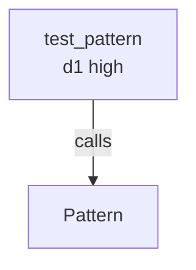

# 07 — Output formats

`--format <FORMAT>` is a global flag (see [02_invocation.md](02_invocation.md)). One of `auto | markdown | json | ndjson | sarif | github | mermaid | dot`. Default is `auto`.

The format dispatcher is `render_by_format` (general) / `render_by_format_with_graph` (graph-shaped verbs) in `crates/lmprobe/src/cli.rs`. Each verb's per-format renderer is wired explicitly; no format auto-derives.

## auto

Resolves at runtime via `std::io::stdout().is_terminal()`:
- TTY → `markdown` (humans).
- Pipe → `ndjson` (machines).

Most users on the command line never set `--format` and get the right thing. Pipelines (`lmprobe search ... | jq`) get NDJSON which streams as it produces.

## markdown

Per-verb markdown renderer. Renders the envelope's hits as a human-readable block. Each verb has its own renderer in `crates/lmprobe/src/output.rs`.

Examples:

```bash
lmprobe search --name Pattern .
# → markdown listing of hits, one block per match.

lmprobe history blame Pattern .
# → "### Blame of `Pattern`" header + per-entry lines.

lmprobe discover --tree .
# → indented hierarchy.
```

`grep -A` / `grep -B` / `grep -C` context-line flags render in markdown and add optional `before_context` / `after_context` arrays to JSON and NDJSON `GrepHit` items. Compact grep hits omit those fields when no context flag is requested.

## json

Pretty-printed JSON of the entire envelope:

```json
{
  "schema": "lmprobe.search.v1",
  "hits": [
    {
      "name": "Pattern",
      "kind": "struct_item",
      "lang": "Rust",
      "file_path": "crates/core/src/matcher/pattern.rs",
      "line_start": 15,
      "content": "pub struct Pattern { ... }"
    }
  ],
  "warnings": [],
  "exit_status": "matched"
}
```

Use `--format json` when you want to pipe to `jq` or feed into structured tooling. The full envelope shape is documented in [08_envelope_schema.md](08_envelope_schema.md).

## ndjson

One JSON object per line. The first N lines are individual items; the last line is a `kind: "summary"` record carrying `schema`, `exit_status`, `warnings`.

```jsonl
{"name":"Pattern","kind":"struct_item","lang":"Rust","file_path":"...","line_start":15,"content":"..."}
{"exit_status":"matched","kind":"summary","schema":"lmprobe.search.v1","warnings":[]}
```

Pipe-friendly: `jq -c` or line-by-line shell processing works directly. Auto-default for piped output.

## sarif

SARIF 2.1.0 — the Static Analysis Results Interchange Format used by GitHub Advanced Security and most code-scanning UIs. Each hit becomes a `runs[0].results[]` entry with file/line. Items without file/line (TraceEvent, Milestone) become driver `notifications`.

```bash
lmprobe --format sarif search --kind class . > out.sarif
gh code-scanning upload out.sarif   # or whatever your CI pipeline expects
```

## github

GitHub Actions workflow-command annotations:

```
::notice file=crates/core/src/matcher/pattern.rs,line=15::Pattern
```

Use in a GitHub Actions workflow to surface hits as PR review comments / annotations. One annotation per hit with a file/line.

## mermaid

GitHub-flavored Mermaid graph syntax. **Only valid on graph-shaped verbs**: `impact`, `callers`, `callees`, `supertypes`, `subtypes`. Other verbs requesting `--format mermaid` fall back to JSON with this stderr note:

```
lmprobe: <verb>: --format Mermaid is only valid on graph-shaped verbs (impact, supertypes, subtypes, callers, callees, context); falling back to JSON
```

Output for `impact` is `graph TD` with `--depth`-banded confidence labels. Other graph verbs use direction `BT` or `LR` per relation:

```
lmprobe --format mermaid impact Pattern --depth 2 .
```



Pastes directly into a GitHub PR comment (which renders mermaid blocks) or `mermaid.live`.

## dot

Graphviz `dot(1)` syntax. Same applicability as Mermaid (graph-shaped verbs only).

```bash
lmprobe --format dot impact Pattern --depth 2 . > impact.dot
dot -Tpng impact.dot -o impact.png
```

```
digraph impact {
  rankdir=LR;
  Pattern [label="Pattern", shape=ellipse];
  test_pattern [label="test_pattern\nd1 high", shape=box];
  test_pattern -> Pattern [label="calls"];
}
```

## Format ↔ verb compatibility

| Verb | markdown | json | ndjson | sarif | github | mermaid | dot |
|------|:-:|:-:|:-:|:-:|:-:|:-:|:-:|
| search / def / ref / find / grep / discover / list-kinds | ✓ | ✓ | ✓ | ✓ | ✓ | – | – |
| callers / callees / supertypes / subtypes / overrides | ✓ | ✓ | ✓ | ✓ | ✓ | ✓ | ✓ |
| imports / exports / decorations | ✓ | ✓ | ✓ | ✓ | ✓ | – | – |
| impact | ✓ | ✓ | ✓ | ✓ | ✓ | ✓ | ✓ |
| context | ✓ | ✓ | ✓ | ✓ | ✓ | – | – |
| history * / ast-diff / evolution | ✓ | ✓ | ✓ | ✓ | ✓ | – | – |
| trace | ✓ | ✓ | ✓ | ✓ | ✓ | – | – |
| fix | ✓ | ✓ | ✓ | ✓ | ✓ | – | – |

`–` means "fall back to JSON with `FORMAT_NOT_APPLICABLE`-style stderr note." See [14_diagnostics.md](14_diagnostics.md).

## Choosing a format

| Use case | Format |
|----------|--------|
| Interactive CLI on a TTY | (auto → markdown) |
| Shell pipeline / `jq` | `json` for one-shot, `ndjson` for streaming |
| CI security scan | `sarif` |
| GitHub Actions PR annotations | `github` |
| Render a call graph for review | `mermaid` (PR comment) or `dot` (offline image) |
| GraphQL output (one-shot) | `lmprobe query '<gql>'` (envelope wrapped in `lmprobe.query.v1`) |

## CLI JSON vs GraphQL naming map

Lmprobe exposes two machine-readable surfaces. They are compatible by meaning and
schema versioning, but field and enum serialization are intentionally surface-native:

- **CLI JSON / NDJSON:** snake_case object keys and lowercase enum-like strings,
  for example:
  - `file_path`, `line_number`, `line_start`, `line_content`, `exit_status`,
    `warnings`
  - `exit_status: "matched" | "no_match" | "error"`
- **`lmprobe query` GraphQL:** camelCase object keys and uppercase enum-like values
  from async-graphql, for example:
  - `filePath`, `lineNumber`, `lineStart`, `lineContent`, `exitStatus`
  - `exitStatus: "MATCHED" | "NO_MATCH" | "ERROR"`

Line anchors are not fully identical across verb families. Today:
- `grep`/`ref` JSON hits use `line_number`; GraphQL typically exposes the same
  anchor as `lineNumber`.
- declaration-like hits (`search`/`def`/`context` et al.) use `line_start`; GraphQL
  exposes `lineStart`.
- some scanner outputs (notably secrets/gitleaks-derived families) still use `start_line`
  in CLI JSON for scan-start anchoring; corresponding GraphQL fields use the
  camelCase line-start variant (`lineStart` / `lineNumber`) on that type's
  selection set.

Do not change either wire format casually. This is a compatibility-sensitive
surface; adapters should map intentionally if their consumers cannot tolerate the
surface-native conventions directly.

## Auto-resolution at the renderer

`render_by_format` (and `render_by_format_with_graph`) take a closure for each per-verb renderer. The closure for `Markdown` is the verb's bespoke human-readable function (e.g. `render_symbol_hits_markdown`); for everything else, the dispatcher calls a generic `serde::Serialize` renderer. Adding a new format means adding a variant to `OutputFormat` enum + a generic renderer + a per-verb closure for graph verbs (if applicable).

## Read next

- [08_envelope_schema.md](08_envelope_schema.md) for the schema-first envelope contract.
- [04_sensors_graph.md](04_sensors_graph.md) for the graph verbs that accept Mermaid/DOT.

## Program JSON transport

Prefer `--json` for program clients: one `lmprobe.result.v1` result with defined
status, payload_format/payload, metadata, and diagnostics. `--outfile` writes it
atomically; `--infile`/`--intfile` loads full GraphQL documents and implies program
JSON. Legacy `--format json` stays sensor-shaped. See
[program-json.md](program-json.md) and its machine-readable JSON Schema for
precise shape, error/partial/exit handling, and output destination safety.
